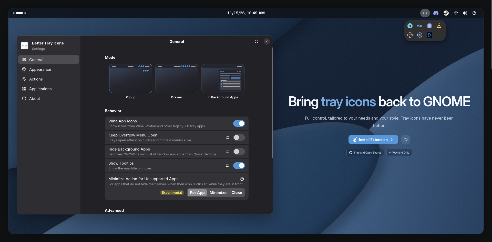

  <picture>
    <source media="(prefers-color-scheme: dark)" srcset="assets/logo.svg" width="264">
    <source media="(prefers-color-scheme: light)" srcset="media/logo-dark.svg" width="264">
    
  </picture>

<h1 align="center">
  
  &nbsp;Better Tray Icons
</h1>

  A GNOME Shell extension that returns tray icons to the top panel. Tidy, configurable and entirely yours.

  
  
  
  
  

  

## About

Better Tray Icons puts tray icons back into the GNOME panel where they belong. You decide how many stay visible, and the rest tuck neatly away into a popup or a drawer behind a toggle button. Or move them all into the Background Apps list in Quick Settings.

Every icon can be renamed, hidden, reordered or swapped out for a custom one. Clicks are fully configurable for both tray icons and the toggle button, with double-click and long-press support. Spacing, padding, colors, the toggle button styling, all of it is up to you.

Settings can be exported, imported and even synced across devices through a shared JSON file with automatic backups.

## Features

Everything you need to tame the tray, and nothing you do not.

&nbsp;✓&nbsp; **Three display modes**: popup as a row or grid, folded into the panel, or simply inside Background Apps. You decide. 
&nbsp;✓&nbsp; **Drag and drop** reordering, wherever the icons are 
&nbsp;✓&nbsp; **Clicks, touch and scroll**: decide what each one does. 
&nbsp;✓&nbsp; **Scroll per app**: scroll through the apps, and where an app supports it, its state or tray icon changes. 
&nbsp;✓&nbsp; **Per-app overrides** to rename, hide, reorder or replace any icon 
&nbsp;✓&nbsp; **Custom styling**: your desktop, your style. Better Tray Icons never gets in your way, design it the way you like it. 
&nbsp;✓&nbsp; **Icon and emoji picker**: pick other icons or even emojis for your apps or the toggle button. It is your design. 
&nbsp;✓&nbsp; **Automatic app detection**: apps are listed as soon as they have been in the tray once. No tedious manual list. Adjust the settings per app whenever you need them. 
&nbsp;✓&nbsp; **Tooltips**: see which app that is, and give each one its own name. 
&nbsp;✓&nbsp; **Symbolic icon mode** for a clean, native look where supported 
&nbsp;✓&nbsp; **Background apps**: hide them, put them in the tray, or move the tray in there. 
&nbsp;✓&nbsp; **Sync between computers**: keep your settings the same on all your devices. Whatever you change comes with you.

## Try it

Not convinced yet? Try Better Tray Icons in the browser before you install it, and see what every single setting does. The full demo lives at [**bti.nexaknight.com**](https://bti.nexaknight.com).

## Installation

The easiest way to get Better Tray Icons is straight from the GNOME Extensions website. One click and you are done.

Prefer building from source? The [Installation wiki page](../../wiki/Installation) has the development version covered.

## Conflicts

Disable any other tray or AppIndicator extension before enabling this one, otherwise both will fight over the same DBus names. The Extensions app warns about this up front, because the conflicting UUIDs are declared in [`metadata.json`](metadata.json):

- `appindicatorsupport@rgcjonas.gmail.com` 
- `ubuntu-appindicators@ubuntu.com`
- `trayIconsReloaded@selfmade.pl`
- `status-tray@keithvassallo.com`
- `quick-settings-tray@soltros`
- `mock-tray@kramo.page`

## Translating

Help with translations is very welcome, both new languages and improvements to existing ones. Have a look at the [translation guidelines](https://github.com/nexaknight/BetterTrayIcons/wiki/Translation-Guidelines) before opening a PR.

## Contributing

This extension could be even better with your help. The [Contributing guide](CONTRIBUTING.md) walks you through setting up the dev environment, filing bug reports and submitting changes.

## Credits

**Project inspiration**

- [AppIndicator/KStatusNotifierItem support for GNOME Shell](https://github.com/ubuntu/gnome-shell-extension-appindicator)
- [Tray Icons: Reloaded](https://github.com/MartinPL/Tray-Icons-Reloaded) by MartinPL
- [Background App Icons](https://github.com/cassidyjames/background-app-icons) by cassidyjames, for the background app menu

**DBus interfaces**

- Interface XML files from the upstream specifications that [AppIndicator](https://github.com/ubuntu/gnome-shell-extension-appindicator) links to

**Preferences layout**

- The About page takes a few cues from [Dash to Panel](https://github.com/home-sweet-gnome/dash-to-panel) by Home Sweet GNOME

**Preference icons**

- Mostly [Lucide](https://github.com/lucide-icons/lucide) (ISC)
- Some derived from [Feather](https://github.com/feathericons/feather) (MIT) by Cole Bemis
- Wine glyph from [MoreWaita](https://github.com/somepaulo/MoreWaita) (GPL-3.0)

Full per-icon attribution and the license texts live in [assets/icons/CREDITS.md](assets/icons/CREDITS.md), the emoji data sources and their license in [assets/emoji/CREDITS.md](assets/emoji/CREDITS.md).

## Support

Better Tray Icons is free and open source. If you would like to support its development, any of these helps.

<!-- donations:start -->

  
  

<!-- donations:end -->

## License

Better Tray Icons is available under the terms of the **GPL v3 or later** license. See [LICENSE](LICENSE) for the full text.

Developed by <a href="https://github.com/nexaknight">NexaKnight</a>. If you like it, consider leaving a star.

